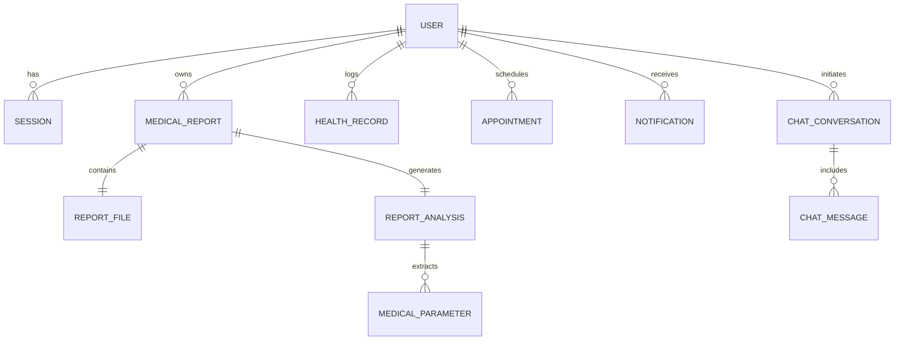

# myHealthMate AI — Database Architecture & Schema

myHealthMate AI uses **PostgreSQL** with **Prisma ORM** for strong relational data integrity, foreign key cascading, and automated migrations.

---

## 1. Relational Entity Diagram



---

## 2. Models & Schema Definitions

### `User`
- `id` (UUID, Primary Key)
- `email` (String, Unique, Indexed)
- `name` (String)
- `passwordHash` (String, bcrypt salted)
- `role` (Enum: `PATIENT`, `ADMIN`)
- `createdAt` / `updatedAt` (Timestamps)

### `MedicalReport`
- `id` (UUID, Primary Key)
- `userId` (Foreign Key -> `User.id`, Cascade Delete)
- `filename` (String)
- `storageKey` (String, Unique, Private Storage Pointer)
- `mimeType` (String: `application/pdf`, `image/png`, `image/jpeg`)
- `fileSize` (Integer Bytes)
- `category` (String)
- `status` (Enum: `UPLOADED`, `PROCESSING`, `COMPLETED`, `FAILED`)

### `ReportAnalysis` & `MedicalParameter`
- Stores normalized biomarkers, measurement units (`mg/dL`, `ng/mL`), numerical values, standard biological reference ranges (`minRange`, `maxRange`), status flags (`NORMAL`, `ELEVATED`, `BORDERLINE`, `LOW`), educational rationale, and clinician discussion questions.

---

## 3. Database Setup & Seeding

1. Start PostgreSQL container via Docker Compose:
   ```bash
   docker-compose up -d db
   ```
2. Run Prisma migrations:
   ```bash
   npx prisma migrate dev --name init
   ```
3. Seed synthetic test accounts and demonstration lab panels:
   ```bash
   node prisma/seed.js
   ```
